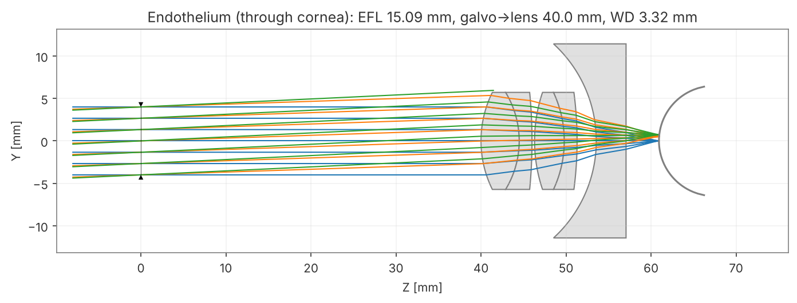
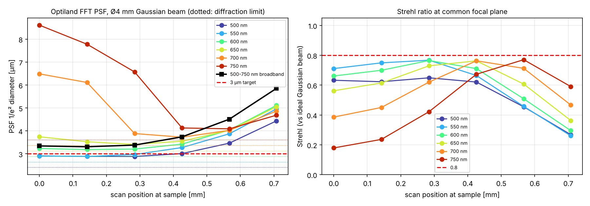
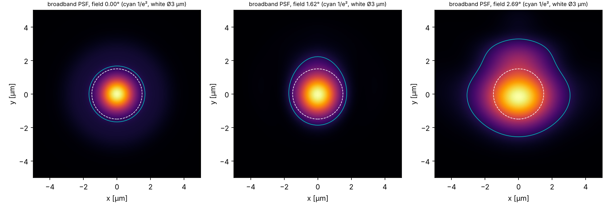
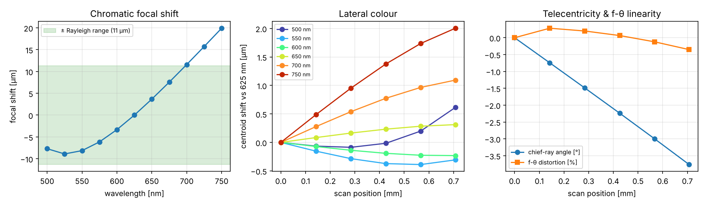

# Visible-light OCT scan lens from off-the-shelf lenses — corneal endothelium imaging

Design of a scan (objective) lens for visible-light OCT built only from catalogue lenses,
simulated and optimised with [Optiland](https://github.com/optiland/optiland).

## Requirements

| Item | Value |
|---|---|
| Wavelength band | 500 – 750 nm (flat spectrum assumed) |
| Input beam | Ø 4 mm (1/e²) Gaussian, collimated, pivoting at the galvo scanner |
| Field of view | 1 mm × 1 mm at the sample (corner radius 0.707 mm) |
| Target | lateral spot ≈ 3 µm; corneal endothelial cells (≈ 20 µm hexagons) easily distinguished |
| Mechanical | galvo → first lens ≥ 10 mm, working distance ≥ 3 mm, lens edge gaps ≥ 0.3 mm |

## Final design

**Thorlabs AC127-019-A  +  Thorlabs AC127-030-A  +  Ø1" N-BK7 plano-concave, f = −30 mm**



| Order | Part | Orientation | Air space after |
|---|---|---|---|
| — | galvo scan pivot (aperture stop) | — | **40.00 mm** |
| 1 | AC127-019-A achromat (f 19 mm, ؽ") | crown (R 12.9) toward galvo | **0.30 mm** (vertex; edge gap ≈ 1.5 mm) |
| 2 | AC127-030-A achromat (f 30 mm, ؽ") | crown (R 17.9) toward galvo | **2.26 mm** |
| 3 | N-BK7 plano-concave f −30 mm (R 15.5 mm, tc 3.5 mm) | concave side toward galvo, flat side toward eye | **3.32 mm** to corneal apex |

* System EFL 15.4 mm in air (15.1 mm including the cornea), scan angle ±2.7° for the 1 × 1 mm field.
* Full prescription: [`results/final_design/endothelium/prescription.md`](results/final_design/endothelium/prescription.md);
  numbers in [`results/final_design.json`](results/final_design.json).
* The plano-concave lens only carries a ~Ø4 mm beam footprint, so a ؽ" f = −30 mm plano-concave
  (R ≈ 15.5 mm) also works and is easier to mount next to the ؽ" achromats — re-check focus if its
  centre thickness differs from 3.5 mm.

### Performance focused on the endothelium (through a model cornea)

Model cornea: anterior R 7.8 mm, thickness 0.55 mm, posterior R 6.5 mm, n_d 1.376, Abbe 56.
The image surface is the curved posterior cornea (endothelium). Broadband = PSFs for 500–750 nm
(11 wavelengths, equal weight) summed including lateral colour; Optiland FFT PSF with Gaussian apodization.

| Scan position | 0 | 0.14 mm | 0.28 mm | 0.43 mm | 0.57 mm | 0.71 mm (corner) |
|---|---|---|---|---|---|---|
| Broadband spot 1/e² diameter | 3.34 µm | 3.31 µm | 3.38 µm | 3.74 µm | 4.51 µm | 5.85 µm |
| (FWHM equivalent) | 1.97 µm | 1.95 µm | 1.99 µm | 2.20 µm | 2.66 µm | 3.45 µm |

* 70 % of the 1 × 1 mm area has a spot ≤ 4.0 µm, 91 % ≤ 4.5 µm, 97 % ≤ 5.0 µm (area mean 3.8 µm).
* Chromatic focal shift −9 … +20 µm over 500–750 nm (Rayleigh range ≈ 11 µm); the far-red end
  (> 700 nm) is the main residual aberration.
* Lateral colour ≤ 2.0 µm, f-θ distortion −0.35 %, chief-ray angle −3.8° at the corner.





### Performance in air (bench test on a flat target)

Same lens spacings, working distance 3.74 mm: broadband spot 3.46 µm on axis, 3.73 µm at 0.43 mm,
4.56 µm at the corner; f-θ distortion < 0.01 %. Plots in [`results/final_design/air/`](results/final_design/air).

### Will it resolve endothelial cells?

Endothelial cells are ≈ 18–22 µm hexagons. With a 3.3–4.5 µm (1/e²) spot over > 90 % of the field,
there are ≥ 4–6 resolution elements per cell and the cell mosaic is transferred with high contrast
(a Gaussian spot of 4.5 µm passes a 20 µm period with ~90 % modulation). Cell borders (< 1 µm wide)
will be blurred to roughly the spot width but should remain clearly visible; axial resolution of a
500–750 nm source (≈ 0.5 µm in tissue) easily separates the endothelium from Descemet's membrane.
Practical limits will be speckle (average several en-face frames) and, in vivo, eye motion.

## Alternative: mostly 1" optics (longer working distance)

**Ø1" N-BK7 plano-concave f = −75 mm  +  Thorlabs AC254-030-A (Ø1")  +  Thorlabs AC127-019-A (ؽ")**

Thorlabs' shortest Ø1" achromat is f = 30 mm, so an all-1" design ends up at EFL ≈ 18–19 mm with
more residual colour (best all-1" result: 4.9–5.1 µm on axis, ≥ 6.2 µm at the corner). Keeping only the
f = 19 mm achromat at ؽ" gives nearly the same resolution as the main design with a much longer
working distance.

| Order | Part | Orientation | Air space after |
|---|---|---|---|
| — | galvo scan pivot | — | **10.01 mm** |
| 1 | Ø1" plano-concave f −75 mm (R 38.8 mm, tc 3.5 mm) | **flat side toward galvo** | **3.15 mm** |
| 2 | AC254-030-A | crown (R 20.89) toward galvo | **0.30 mm** (vertex; ≈ 2.2 mm at the ؽ" lens rim) |
| 3 | AC127-019-A | crown (R 12.9) toward galvo | **9.12 mm** to corneal apex (9.53 mm in air) |

| Broadband 1/e² spot | 0 | 0.14 | 0.28 | 0.43 | 0.57 | 0.71 mm |
|---|---|---|---|---|---|---|
| Main design (½" achromats) | 3.34 | 3.31 | 3.38 | 3.74 | 4.51 | 5.85 µm |
| 1"-based design | 3.37 | 3.40 | 3.57 | 4.00 | 4.80 | 6.45 µm |

* 1"-based: 57 % of the 1 × 1 mm area ≤ 4.0 µm, 82 % ≤ 4.5 µm, 93 % ≤ 5.0 µm (main design 70/91/97 %).
* Working distance 9.1 mm (vs 3.3 mm) — much more practical for in-vivo imaging; but the galvo pivot
  sits only 10 mm in front of the first lens (the lower bound of the optimisation).
* In air: 3.46 → 4.36 µm (centre → corner). Plots: [`results/final_design_1inch/`](results/final_design_1inch).

## Why not exactly 3 µm everywhere?

A 3 µm 1/e² Gaussian spot from a 4 mm beam requires EFL ≤ 12.6 mm at 750 nm *and* essentially perfect
correction across a 250 nm band. Stock achromats are corrected for ≈ 486–656 nm; their residual colour
is the dominant error (two-achromat designs reach only ~4.7 µm on axis). The weak negative N-BK7 lens
cancels most of the linear focal shift and part of the field curvature, which brings the centre of the
field to ~3.3 µm. Further improvement would need a custom or apochromatic element, or a larger beam
(e.g. Ø 5–6 mm) at the scanner.

## Method

1. **Catalogue** (`scanlens/catalog.py`): Thorlabs AC254/AC127 achromats + generic N-BK7 plano-concave
   lenses. Each achromat prescription was checked by recomputing its EFL (`python -m scanlens.check_catalog`,
   all < 1 % from nominal); entries that failed were removed.
2. **Pre-screen** (`scanlens/design.py`, fast numpy tracer `scanlens/raytrace.py`): all 2-doublet
   combinations (102) and 2-doublet + negative-singlet combinations (1273), every orientation and
   order; air spaces optimised for each. The tracer was validated against Optiland
   (EFL to 1e-8 mm, RMS wavefront error within 0.5 %, PSF diameter within 1 %).
3. **Optiland refinement** (`scanlens/optiland_optimize.py`, `scanlens/refine.py`, `scanlens/polish.py`):
   the top 16 candidates re-optimised in Optiland with the cornea model, merit = broadband FFT-PSF 1/e²
   diameter at 3 field points + edge-clearance constraints.
4. **Analysis** (`scanlens/optiland_analysis.py`): Optiland FFT PSF, spot diagrams, field curvature,
   focal shift, lateral colour, telecentricity and distortion.

```bash
pip install -r requirements.txt
python -m scanlens.check_catalog
python -m scanlens.design 2                     # 2-element pre-screen
python -c "from scanlens.design import run_hybrid; run_hybrid('results/hybrid.json')"
python -m scanlens.refine 16 4 results/optiland_refined_cornea.json --cornea results/prescreen_all_fov1mm.json
python -m scanlens.polish results/optiland_refined_cornea.json results/optiland_polished_cornea.json 4 --cornea
```

## Before building — please check

* **Verify every prescription against the vendor Zemax/datasheet files** (vendor websites were not
  reachable from the design environment; values were entered from catalogue data and only verified via
  EFL). Re-run `scanlens/optiland_analysis.py` with the verified values.
* Choose a specific plano-concave part number with f = −30 mm (R ≈ 15.5 mm) and update its thickness.
* The 0.30 mm vertex gap between the two achromats needs a thin spacer (edge gap ≈ 1.5 mm).
* No tolerance analysis has been done yet; spacing/decentre sensitivity should be checked
  (Optiland has a `tolerancing` module).
* For in-vivo use, check the working distance (3.3 mm to the corneal apex) and the light-safety limits
  for visible light on the cornea/retina (ISO 15004-2 / ANSI Z80.36).
* "-A" coated achromats are specified for 400–700 nm; consider "-AB" (400–1100 nm) for 700–750 nm.
